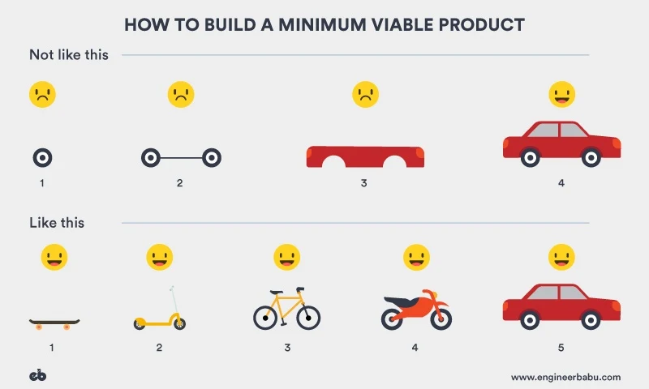
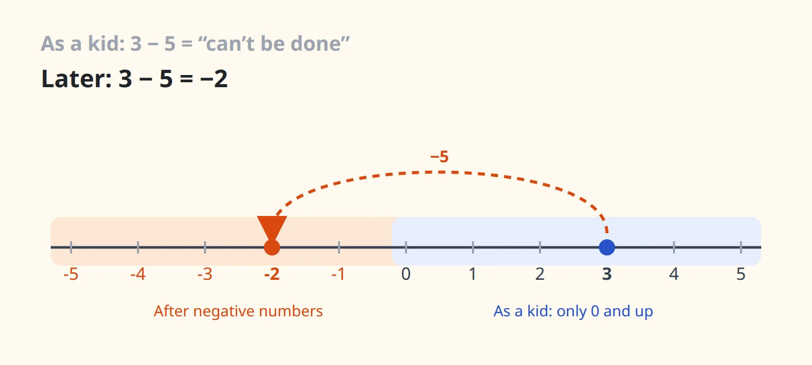
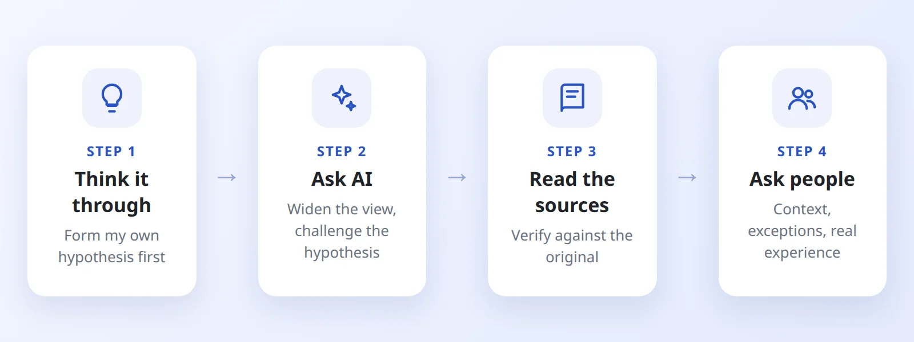

I'm someone with a lot of questions. About code, about products, and about all kinds of other things in this world. Over time I've noticed that the way I learn doesn't start with memorizing answers. It starts with **questioning the very thing I'm being taught**.

This post is about one of those times, while I was studying product thinking.

## The MVP picture

If you've ever learned about startups or product work, you've probably seen this picture:

It's titled "How to build a minimum viable product" and has two rows:

- **Not like this:** build a wheel, then two wheels on an axle, then the body, and only at the very last step do you get a car. For the first three steps the user is unhappy, because there's nothing they can use.
- **Like this:** a skateboard, then a scooter, a bicycle, a motorbike, and finally a car. The user is happy at every step, because at every step they have something to get around with.

The message is clear: every version should be usable on its own, so you learn from real users instead of building in the dark until the last minute.

## The first question: is it wrong?

Honestly, my first reaction was doubt. **Is the top row really wrong when you apply it in practice?** Sometimes I actually lean toward the first approach.

When I build products for real, I rarely make a skateboard and then throw it away to build a scooter. Once the goal is clear, I break the product into parts and build them up until it's complete. And now, with AI speeding up the building, going straight for the car can be faster, and more likely to succeed, than making five different vehicles.

So is the picture wrong? Or am I?

## The second question: why is this being taught?

Instead of concluding right away, I turned the question around: **why does this example exist? And why did the lecturer choose it for today's lesson?** An example that has been used for so many years probably has a reason. Is it still true, now that AI has changed how fast products get built?

## Slowing down for a beat

Then I slowed down and reread the title. The picture isn't about how to build a product. It's about an **MVP**: the smallest version that is still usable, built to check whether users actually need what you're planning to make.

And that day's lesson wasn't "this is the only way to build a product". It was there to help us tell **what is an MVP and what isn't**. A wheel isn't an MVP, because nobody can use it. A skateboard is, because it already solves the need to get around, however roughly.

Once you're past that validation stage, once the goal is clear and you know users need the car, building it part by part, with AI speeding things up, makes perfect sense.

So the picture wasn't wrong. It's just **true within its scope**, and I needed that exact example to understand the lesson properly.

## The bigger lesson: true within a scope

This reminded me of being taught as a kid that **you can't subtract a bigger number from a smaller one**. With what I knew then, that was completely true: if you have 3 sweets, you can't give away 5. A few years later I learned about negative numbers, and found out that 3 minus 5 does have an answer: −2.

The childhood lesson wasn't wrong. It was only true within the numbers I knew at the time. A lot of what we're taught, even at work, is like that. Whenever something "seems wrong", the more useful question is often: **within what scope is this true, and where am I standing right now?**

## How I look for answers

When a question comes up, I usually go through four steps, in this order:

1. **Think it through myself.** I want my own answer first, even if it's wrong. With a hypothesis in my head, whatever I read or hear next has something to be compared against, instead of just being absorbed.
2. **Ask AI.** To widen my view and challenge my hypothesis. AI is very good at raising angles I hadn't thought of. But I treat its answer as a lead to verify, not a conclusion.
3. **Look for sources.** To check against the original: the source article, books, official documentation. This is the step that turns "sounds right" into "I know why it's right".
4. **Ask other people.** People with real experience often give me what documents don't: context, the times it failed in practice, and the exceptions. By this point my question is also specific enough not to waste their time.

## The habit follows me to work

This way of questioning isn't only for studying. At work, it helps me see things that are easy to miss:

- A conversation count that was wrong had been patched many times, and a few days later it would drift again. Instead of patching it once more, I asked: **why is this number always off?** The answer was that it was calculated on the frontend, with no source of truth from the backend.
- Looking at the architecture of the tools behind our AI agents, one very simple question, **"whose identity does this tool run as?"**, led me to a security hole that many people had walked past without seeing. I wrote about it in detail in [this post](../ai-tim-lo-hong-bao-mat-mcp-gcp/).

## Wrapping up

I don't think questioning is about proving the teacher wrong. Most of the time I end up finding that the lesson is right, just right within a scope I couldn't see at first. But going through the doubt, the turned-around question, the pause, and the checking, I understand the lesson far more deeply than if I had just memorized it.

There's still so much in this world I wonder about. If you also have a question you haven't been able to answer, feel free to [email me](mailto:phantronghau.dev@gmail.com). Maybe we'll figure it out together.
