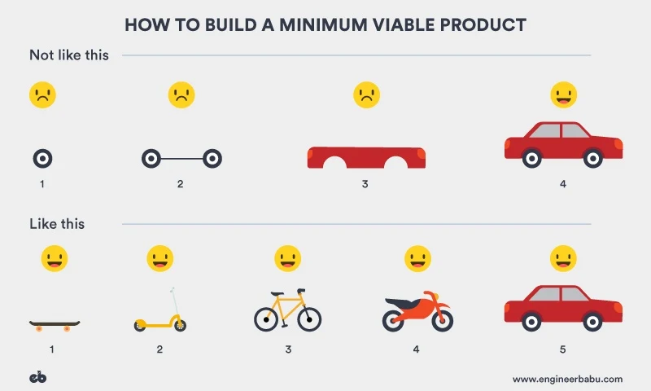
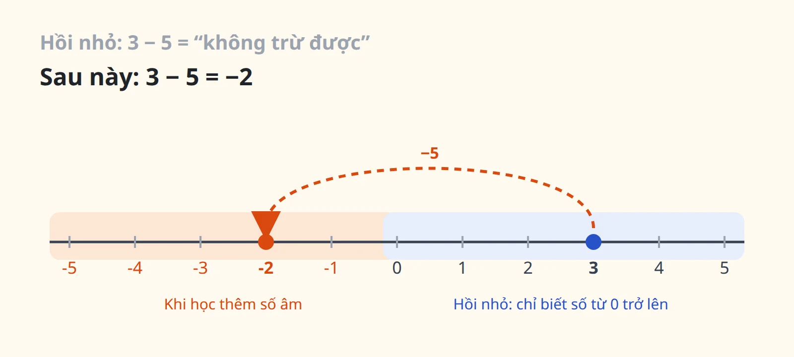

Mình là người có rất nhiều thắc mắc. Về code, về sản phẩm, và về đủ thứ khác trong thế giới này. Lâu dần mình nhận ra cách mình học không bắt đầu từ việc ghi nhớ đáp án, mà từ việc **tự đặt câu hỏi cho chính điều mình đang được dạy**.

Bài này kể lại một lần như vậy, khi mình đang học về product thinking.

## Bức hình về MVP

Nếu bạn từng học về khởi nghiệp hay làm sản phẩm, chắc bạn đã gặp bức hình này:

Tiêu đề là "Cách xây dựng một MVP (sản phẩm khả thi tối thiểu)", gồm hai hàng:

- **Không nên như thế này:** làm một cái bánh xe, rồi hai bánh xe nối trục, rồi thân xe, và mãi tới bước cuối mới có chiếc ô tô. Ba bước đầu, người dùng đều không vui, vì chẳng có gì dùng được.
- **Mà nên như thế này:** ván trượt, rồi xe scooter, xe đạp, xe máy, và cuối cùng là ô tô. Bước nào người dùng cũng vui, vì bước nào họ cũng có thứ để di chuyển.

Thông điệp rất rõ: mỗi phiên bản phải tự nó dùng được, để mình học được từ người dùng thật thay vì làm trong bóng tối tới phút cuối.

## Câu hỏi đầu tiên: liệu nó có sai?

Thú thật, phản ứng đầu tiên của mình là nghi ngờ. **Hình phía trên có thật sự sai khi áp dụng vào thực tế không?** Có những lúc mình còn thiên về cách làm đầu tiên hơn.

Thực tế khi làm sản phẩm, mình hiếm khi làm ra một chiếc ván trượt rồi vứt đi để làm xe scooter. Khi mục tiêu đã rõ, mình chia sản phẩm thành từng phần và xây dần cho tới khi hoàn chỉnh. Và bây giờ, với AI giúp tăng tốc việc xây dựng, đi thẳng tới chiếc ô tô có khi còn nhanh hơn và dễ thành công hơn là làm năm phương tiện khác nhau.

Vậy là bức hình sai? Hay mình sai?

## Câu hỏi thứ hai: tại sao người ta lại dạy điều này?

Thay vì kết luận ngay, mình hỏi ngược lại: **tại sao người ta đưa ra ví dụ này? Và tại sao giảng viên lại chọn nó cho bài học hôm nay?** Một ví dụ được dùng đi dùng lại nhiều năm như vậy chắc phải có lý do. Nó còn đúng không, trong thời điểm mà AI đã thay đổi tốc độ làm sản phẩm?

## Chậm lại một nhịp

Rồi mình chậm lại và đọc kỹ lại tiêu đề. Bức hình không nói về cách xây một sản phẩm. Nó nói về **MVP**: phiên bản nhỏ nhất mà vẫn dùng được, để kiểm chứng xem người dùng có thật sự cần thứ mình định làm hay không.

Bài học hôm đó cũng không phải "đây là cách duy nhất để làm sản phẩm". Nó giúp tụi mình phân biệt **cái gì là MVP và cái gì không phải là MVP**. Một cái bánh xe không phải là MVP, vì không ai dùng được nó. Một chiếc ván trượt thì là MVP, vì nó đã giải quyết được nhu cầu di chuyển, dù còn rất thô.

Còn khi đã qua giai đoạn kiểm chứng, khi mục tiêu đã rõ và mình biết chắc người dùng cần chiếc ô tô, thì xây theo từng phần, với AI tăng tốc, là hoàn toàn hợp lý.

Hoá ra bức hình không sai. Nó chỉ **đúng trong phạm vi của nó**, và mình cần chính ví dụ đó để hiểu bài học cho rõ.

## Bài học lớn hơn: đúng trong một phạm vi

Chuyện này nhắc mình nhớ hồi nhỏ, khi được dạy rằng **số bé không thể trừ cho số lớn**. Với những gì mình biết lúc đó, điều này hoàn toàn đúng: có 3 cái kẹo thì không thể cho đi 5 cái. Vài năm sau học tới số âm, mình mới biết 3 trừ 5 vẫn ra một kết quả, là −2.

Bài học hồi nhỏ không sai. Nó chỉ đúng trong phạm vi những con số mình biết lúc đó. Rất nhiều điều mình được dạy, kể cả khi đã đi làm, cũng giống vậy. Mỗi lần thấy một điều "có vẻ sai", câu hỏi hữu ích hơn thường là: **điều này đúng trong phạm vi nào, và mình đang đứng ở đâu?**

## Cách mình đi tìm câu trả lời

Khi một thắc mắc nảy ra, mình thường đi theo bốn bước, lần lượt theo thứ tự này:

1. **Tự ngồi nghĩ.** Mình muốn có câu trả lời của riêng mình trước, dù chưa đúng. Có một giả thuyết trong đầu thì những gì đọc hay nghe sau đó mới có chỗ để so sánh, thay vì chỉ tiếp nhận.
2. **Hỏi AI.** Để mở rộng góc nhìn và thử thách giả thuyết của mình. AI rất giỏi đưa ra những phía mình chưa nghĩ tới. Nhưng mình coi câu trả lời của AI là gợi ý để kiểm chứng, không phải kết luận.
3. **Tìm tài liệu.** Để kiểm chứng bằng nguồn gốc: bài viết gốc, sách, tài liệu chính thức. Đây là bước biến "nghe có vẻ đúng" thành "mình biết vì sao nó đúng".
4. **Hỏi người khác.** Người có kinh nghiệm thật thường cho mình thứ mà tài liệu không có: bối cảnh, những lần áp dụng thất bại, và những ngoại lệ. Tới bước này mình cũng đã có câu hỏi đủ cụ thể để không làm mất thời gian của họ.

## Thói quen này theo mình vào công việc

Cách tự hỏi này không chỉ dùng khi học. Khi làm việc, nó giúp mình nhìn thấy những thứ dễ bị bỏ qua:

- Một lỗi đếm số hội thoại bị sai đã được vá nhiều lần mà vài hôm sau lại tái diễn. Thay vì vá thêm lần nữa, mình hỏi: **vì sao số này luôn lệch?** Câu trả lời nằm ở chỗ nó được tính ở frontend mà không có nguồn dữ liệu chuẩn từ backend.
- Khi nhìn kiến trúc các tool cho AI agent, một câu hỏi rất đơn giản, **"tool này chạy bằng danh tính của ai?"**, đã dẫn mình tới một lỗ hổng bảo mật mà nhiều người đã đi qua mà không thấy. Mình có kể chi tiết trong [bài viết này](../ai-tim-lo-hong-bao-mat-mcp-gcp/).

## Kết

Mình không nghĩ tự hỏi là để chứng minh người dạy sai. Phần lớn thời gian, cuối cùng mình nhận ra bài học đúng, chỉ là đúng trong một phạm vi mà lúc đầu mình chưa thấy. Nhưng đi qua quá trình nghi ngờ, hỏi ngược, chậm lại và kiểm chứng, mình hiểu bài học đó sâu hơn rất nhiều so với việc chỉ ghi nhớ nó.

Thế giới này còn rất nhiều điều mình thắc mắc. Nếu bạn cũng có một câu hỏi mà mãi chưa tìm ra lời giải, cứ [email cho mình](mailto:phantronghau.dev@gmail.com), biết đâu mình cùng nghĩ ra.
